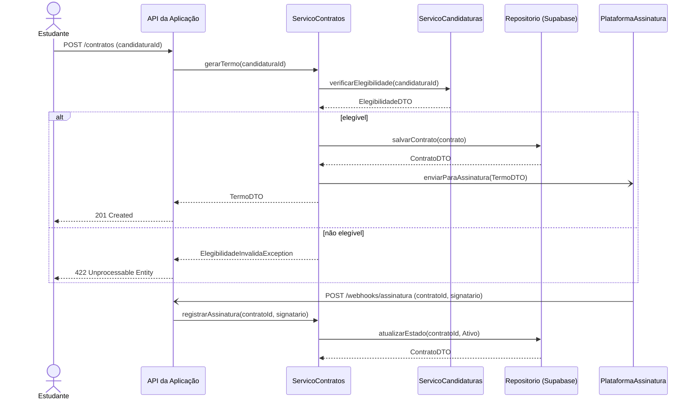
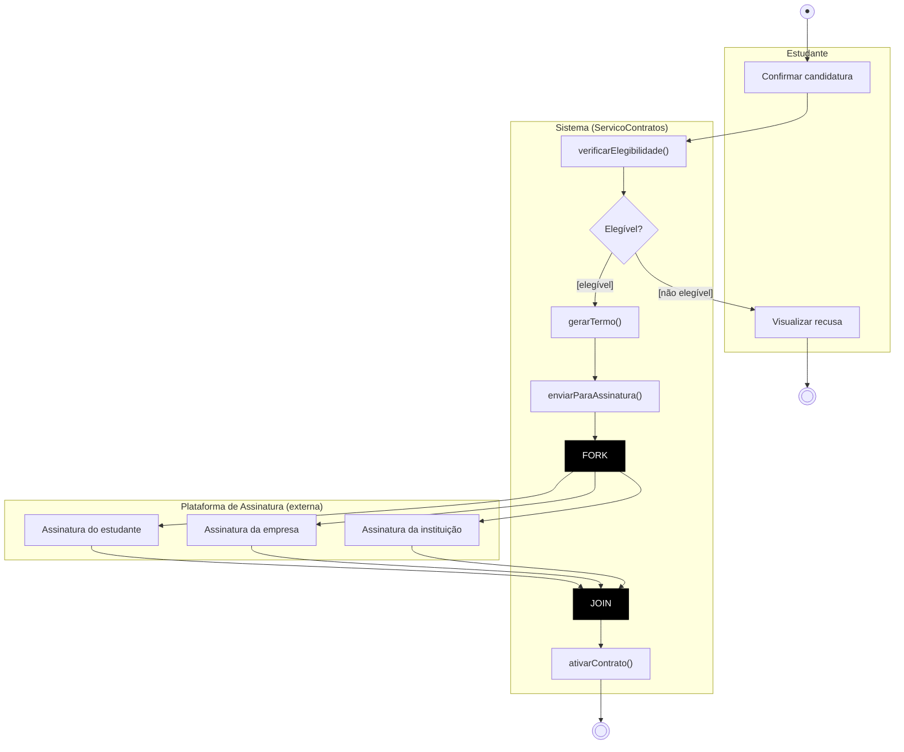
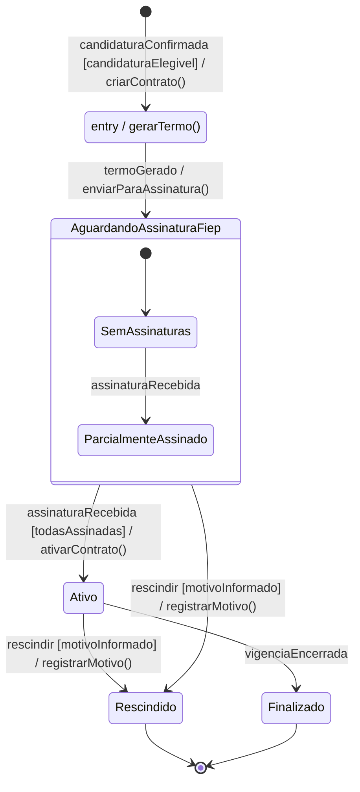
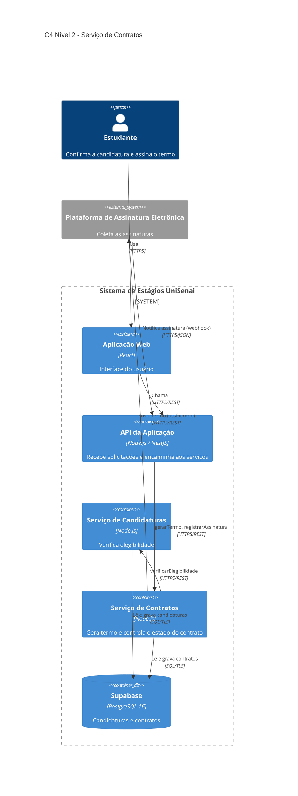

# APS 3 — Serviço de Contratos

**Aluno:** [Seu Nome]  |  **Projeto:** Gestão de Aprendizagem e Estágios da UniSenai (Grupo 6)

## Funcionalidade
Depois que a candidatura do estudante é confirmada e considerada elegível, o **Serviço de Contratos** gera o Termo de Compromisso e envia para a plataforma de assinatura externa. Quando todas as assinaturas chegam, o contrato fica **Ativo**.

**Operações públicas por linha de vida** (regra de consistência do Diagrama de Sequência):

| Linha de vida | Operações públicas |
|---|---|
| `ServicoContratos` | `gerarTermo(candidaturaId): TermoDTO`, `registrarAssinatura(contratoId, signatario): ContratoDTO` |
| `ServicoCandidaturas` | `verificarElegibilidade(candidaturaId): ElegibilidadeDTO` |
| `Repositorio` | `salvarContrato(contrato): ContratoDTO`, `atualizarEstado(contratoId, estado): ContratoDTO` |
| `PlataformaAssinatura` | `enviarParaAssinatura(TermoDTO)` |
| `API da Aplicação` | `POST /contratos`, `POST /webhooks/assinatura` |

## 1. Diagrama de Sequência

## 2. Diagrama de Atividades

## 3. Diagrama de Estados

## 4. C4 Nível 2 (Contêineres)

## 5. ADR
[ADR 0001 — Assinatura assíncrona via webhook](docs/architecture/adr-0001.md)
