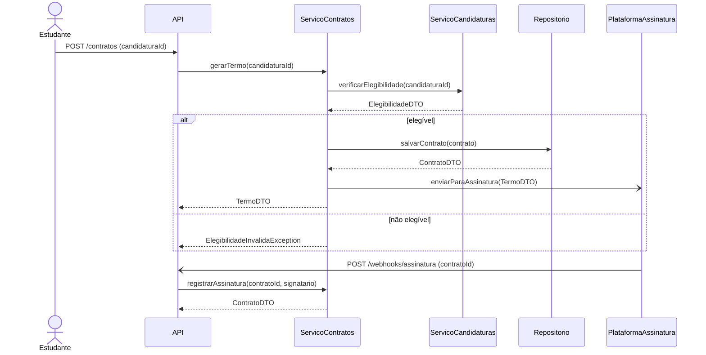
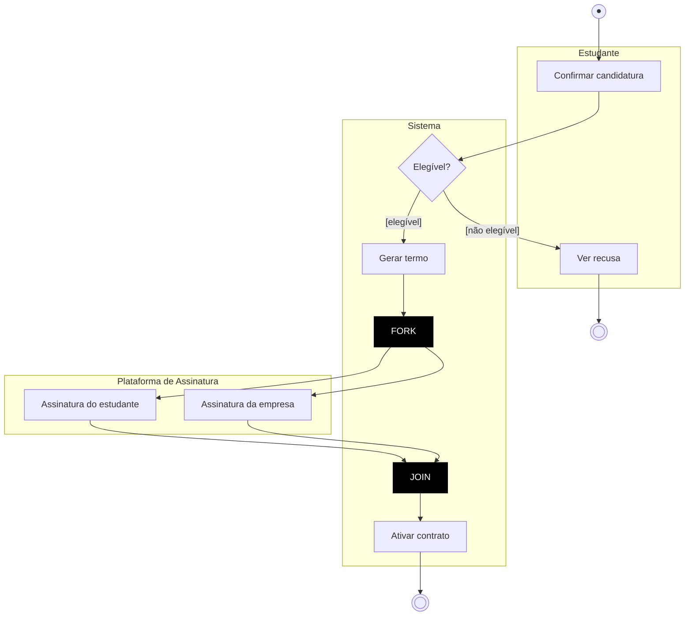
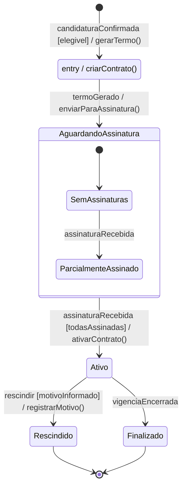
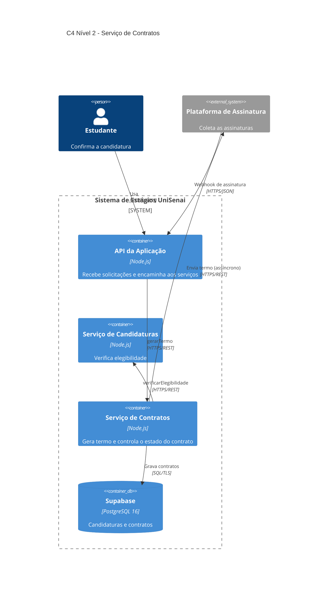

# APS 3 — Serviço de Contratos

**Aluno:** João Pedro Costa Silva  |  **Projeto:** Gestão de Aprendizagem e Estágios da UniSenai (Grupo 6)

## Funcionalidade
Depois que a candidatura do estudante é confirmada e considerada elegível, o **Serviço de Contratos** gera o Termo de Compromisso e envia para a plataforma de assinatura externa. Quando as assinaturas chegam, o contrato fica **Ativo**.

| Linha de vida | Operações públicas |
|---|---|
| `ServicoContratos` | `gerarTermo(candidaturaId): TermoDTO`, `registrarAssinatura(contratoId, signatario): ContratoDTO` |
| `ServicoCandidaturas` | `verificarElegibilidade(candidaturaId): ElegibilidadeDTO` |
| `Repositorio` | `salvarContrato(contrato): ContratoDTO` |
| `PlataformaAssinatura` | `enviarParaAssinatura(TermoDTO)` |
| `API` | `POST /contratos`, `POST /webhooks/assinatura` |

## 1. Diagrama de Sequência

## 2. Diagrama de Atividades

## 3. Diagrama de Estados

## 4. C4 Nível 2 (Contêineres)

## 5. ADR 0001 — Assinatura assíncrona via webhook

### Status
Proposto

### Contexto
O Serviço de Contratos envia o Termo de Compromisso para uma plataforma de assinatura externa. Os signatários levam minutos ou dias para assinar, e a plataforma pode ficar lenta ou indisponível. Uma chamada síncrona prenderia a requisição do estudante.

### Decisão
O termo é enviado de forma assíncrona (`enviarParaAssinatura`) e a API responde na hora. As assinaturas voltam por webhook (`POST /webhooks/assinatura`), que chama `registrarAssinatura`. O contrato só vai para `Ativo` quando todas as assinaturas chegarem.

### Consequências
**Vantagens:**
- A API não fica presa à plataforma externa.
- Uma falha da plataforma não derruba a candidatura.

**Riscos aceitos:**
- O estado do contrato só atualiza quando o webhook chega.
- O webhook precisa ser autenticado e tratado de forma idempotente.
